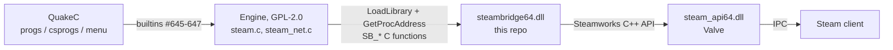

# SteamBridge

Steamworks for DarkPlaces-derived engines (Zircon Beta 20251028 and later),
without putting a single Steam header into the engine.

SteamBridge is a small Windows DLL, `steambridge64.dll`, that links the
Steamworks SDK and exports a flat C API. The engine loads it at runtime by name
and resolves each function by string. If the DLL, Valve's `steam_api64.dll`, the
`steam_appid.txt` file, or a running Steam client is missing, the engine prints
one line and carries on without Steam.

What it gives the engine:

- Steam API start-up, per-frame callbacks, shutdown, the local SteamID64
- **Steam Datagram Relay networking**: a server gets a FakeIP, an `ip:port` from a
  range Steam reserves, that clients `connect` to like any IPv4 address; no port
  forwarding
- Rich presence and a public lobby, so friends can join from the Steam friends list
- Friend invites, through the overlay or by SteamID64
- Achievements: unlock and clear
- Opening a web page in the Steam overlay



## Repository layout

| Path | Contents |
| --- | --- |
| `bridge/` | The DLL: `exports.cpp` (every exported function), `steam.cpp` (init, frame, SteamID, URL), `steam_net.cpp` (SDR sockets and FakeIP), `steam_lobby.cpp` (lobby, rich presence, invites), `achievement.cpp`. `workshop.cpp` is compiled but nothing from it is exported yet. |
| `engine_source/` | A Zircon Beta 20251028 tree carrying the original engine-side patch in `engine_source/kleskby/`. Current Zircon releases already contain this integration (`steam.c`, `steam_net.c`, `prvm_steam.h` at the tree root), so this copy is a reference for porting into older or other DarkPlaces trees. |
| `sdk/` | **Not in the repository.** You unpack the Steamworks SDK here yourself (see below). Gitignored. |
| `docs/` | [API reference](docs/API.md), [engine integration](docs/ENGINE_INTEGRATION.md), [QuakeC usage and examples](docs/QC.md). |

## Building the DLL

Requirements: Windows, Visual Studio 2022 with the C++ desktop workload
(toolset v143, C++17), and the Steamworks SDK. The code was built and tested
against **SDK 1.62**.

1. Download the Steamworks SDK from the Steamworks partner site and unpack it so
   these paths exist:

   ```
   sdk/public/steam/steam_api.h
   sdk/redistributable_bin/win64/steam_api64.lib
   sdk/redistributable_bin/win64/steam_api64.dll
   ```

2. Build **Release | x64**, either from `SteamBridge.sln` in Visual Studio or on
   the command line:

   ```bat
   "C:\Program Files\Microsoft Visual Studio\2022\Community\MSBuild\Current\Bin\MSBuild.exe" SteamBridge.sln -p:Configuration=Release -p:Platform=x64
   ```

3. The output is `x64\Release\steambridge64.dll`.

MSBuild prints two `MSB8012` warnings because the linker writes
`steambridge64.dll` while the project's `TargetName` is `steambridge`. They are
harmless: the `64` suffix is added on purpose, since that is the name the
engine looks for. Only the x64 configurations are maintained; the Win32 ones
are stale (`Release|Win32` is even set to build an `.exe`).

Check that every function the engine needs is exported:

```bat
dumpbin /exports x64\Release\steambridge64.dll
```

You should see the 20 `SB_*` names listed in [docs/API.md](docs/API.md).

## Deploying with a game

Three files go **next to the engine executable**, and the game must be started
with that folder as its working directory (Steam does this; so does a shortcut
whose "Start in" is the game folder). Current Zircon also calls
`SetDllDirectory("bin64")` before loading, so the two DLLs may live in `bin64\`
instead; `steam_appid.txt` must stay in the working directory.

| File | Where it comes from | Why |
| --- | --- | --- |
| `steambridge64.dll` | `x64\Release\` after building | The bridge itself |
| `steam_api64.dll` | `sdk\redistributable_bin\win64\` | Valve's runtime; the bridge links against it |
| `steam_appid.txt` | You write it | The app ID, used when the game is *not* launched by Steam |

The engine checks for `steam_appid.txt` **before** it touches the DLL. No file
means no Steam, silently (the message only shows with `developer 1`). That makes
the file the on/off switch.

### App ID 480 for testing

`480` is Spacewar, Valve's public test application. Every Steam account can run
it, so a `steam_appid.txt` containing just

```
480
```

turns on the whole bridge (SDR networking, invites, the overlay, rich presence)
without owning a Steamworks app. Your friends list will show you as playing
"Spacewar". Achievements are the exception: they only exist for achievement
names configured on the app, and Spacewar's are Valve's
(`ACH_WIN_ONE_GAME`, `ACH_WIN_100_GAMES`, `ACH_HEAVY_FIRE`,
`ACH_TRAVEL_FAR_ACCUM`, `ACH_TRAVEL_FAR_SINGLE`), so your own names fail with
`SetAchievement failed` until you use your real app ID. Unlocking one of
Spacewar's from a test build is a quick end-to-end check; clear it again with
the lock call.

### Shipping on Steam

Replace `480` with your own app ID while testing, and do not ship
`steam_appid.txt` in the depot: when Steam launches the game it supplies the
app ID itself, and a stray file can point the game at the wrong app.

## Troubleshooting

Messages appear in the engine console. Bridge messages are routed back through
the engine with `echo`, so they show up in the console log too.

| Message | Meaning |
| --- | --- |
| `Steam: missing steam_appid.txt, skipping steam.` (developer only) | No `steam_appid.txt` in the working directory. Steam is off by design. |
| no `Steam:` line at all; with `developer 1`, `Trying to load library... "steambridge64.dll"` and no success | `steambridge64.dll` or `steam_api64.dll` could not be loaded. Check both are beside the exe (or in `bin64\`). |
| `SteamAPI_Init error`, then `Steam: Error initializing steam` | Steam client not running, or the app ID is not one this account can run. |
| `Steam: Steam user is not logged in` | Steam is running but offline or at the login screen. |
| `Steam: successfully initialized` | Working. `steam_steamid` now holds your SteamID64. |
| `SteamNet: CreateListenSocketP2PFakeIP failed` | The server could not open its relay socket; `developer_steam 1` shows the networking library's reason. |
| `steam_invite: steam_fakeip is empty` | You are not hosting, or the FakeIP request has not completed. |
| `SetAchievement failed: NAME` | `NAME` is not an achievement of the current app ID. |
| `Steam not initialized, ignoring achievement: NAME` | Game code called an achievement builtin although Steam did not start. Harmless; test `steam_steamid` first to avoid it. |

`developer_steam 1` prints the networking library's own warnings, which arrive
as `steam_echo` commands and are hidden otherwise.

## Licensing

- The bridge source in this repository is licensed under the GNU GPL v3; see
  [`LICENSE`](LICENSE).
- `engine_source/` is a DarkPlaces/Zircon tree under the GNU GPL v2; see
  `engine_source/COPYING`.
- The Steamworks SDK (headers, `steam_api64.lib`, `steam_api64.dll`) belongs to
  Valve and is covered by the Steamworks SDK Access Agreement. None of it is in
  this repository; you download it yourself, and you may only redistribute
  `steam_api64.dll` under Valve's terms.
- The engine side contains no Steam headers, no Steam types, and does not link
  against the SDK. It loads `steambridge64.dll` at runtime and calls it only
  through C function pointers resolved by name.

Whether that arrangement meets your own licensing obligations is for you to
assess.
